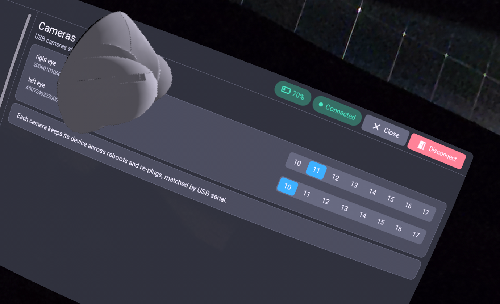
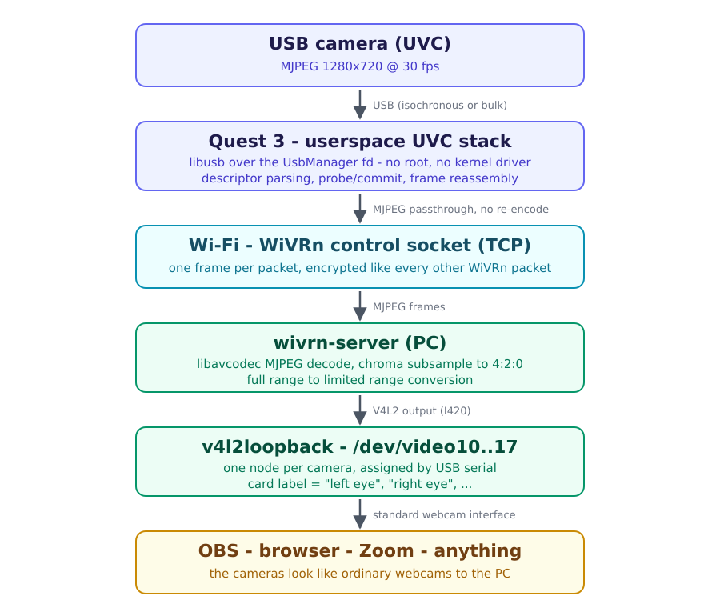

<h1 align="center">WiVRn &mdash; USB camera passthrough fork</h1>

<p align="center"></p>

This is a fork of [WiVRn](https://github.com/WiVRn/WiVRn) that adds **USB (UVC)
camera passthrough from the headset to the PC**. Completely done by deepseek. Slop probably included.

Plug a webcam into a Meta Quest 3, and it shows up on the Linux PC as
`/dev/video10` (or 11, 12, ...) through
[v4l2loopback](https://github.com/v4l2loopback/v4l2loopback). Any application that
can use a webcam (OBS, Firefox, Chrome, Zoom, Discord, ...) sees it, over Wi-Fi,
while the headset is streaming.

No root, no custom kernel, no Camera2: the headset has no `uvcvideo` driver, so
the cameras are driven from userspace with libusb.

Everything upstream still works; this fork only adds the camera feature (plus a
small amount of plumbing in the WiVRn protocol and settings UI).

---

## What it looks like

`Settings -> Cameras` in the in-stream WiVRn menu: each physical camera keeps a
fixed `/dev/videoN`, matched by USB serial, and the mapping is persisted.



Two cameras streaming into `/dev/video10` and `/dev/video11` at the same time:

```console
$ ffprobe -v error -f v4l2 -i /dev/video10 -show_entries stream=width,height -of csv=p=0
1280,720
$ ffprobe -v error -f v4l2 -i /dev/video11 -show_entries stream=width,height -of csv=p=0
1280,720
```

Server log while both are running:

```console
INFO [load_camera_config] Loaded 2 camera assignment(s) from cameras.json
INFO [update_cameras] Camera 200901010001 (right eye) -> /dev/video11
INFO [update_cameras] Camera A007240223000154 (left eye) -> /dev/video10
INFO [send_camera_stream_description] Streaming 2 camera(s) from the headset
INFO [configure] Camera 0: streaming 1280x720 I420 (stride 1280) to /dev/video11
INFO [configure] Camera 1: streaming 1280x720 I420 (stride 1280) to /dev/video10
```

---

## Pipeline



```
USB camera (MJPEG)
  -> Quest 3: userspace UVC over libusb (UsbManager fd, no root)
  -> WiVRn control socket over Wi-Fi (MJPEG frames, encrypted like every packet)
  -> wivrn-server: libavcodec MJPEG -> I420, full range -> limited range
  -> v4l2loopback /dev/video10..17
  -> OBS / browser / Zoom / anything
```

### Why userspace UVC?

| Attempt | Result |
|---|---|
| Camera2 API | Only exposes Quest *virtual* cameras; the UVC cameras are invisible |
| Kernel `uvcvideo` | `CONFIG_MEDIA_USB_SUPPORT` is not set in the Quest kernel, and there is no root to change it |
| PipeWire `Video/Source` on the PC | Crashed inside PipeWire's own `videoconvert` during negotiation |
| **libusb over the UsbManager fd** | **Works**, no root, no kernel changes |

The camera stream is MJPEG all the way through: it is never decoded on the
headset and never re-encoded, so the CPU cost on the Quest is just USB reads and
a memcpy.

---

## Requirements

**Headset**

- Meta Quest 3 (Horizon OS / Android 14). Other Android headsets may work; the
  USB permission names below are Meta-specific.
- `android.permission.CAMERA` and `horizonos.permission.USB_CAMERA`.
  Both are declared by the app; grant them with `adb shell pm grant` (see below).
  Without the second one, `UsbManager.requestPermission()` is denied with no
  dialog for any UVC device.
- A UVC camera that exposes **MJPEG**. YUYV-only cameras are rejected (see
  [Limitations](#limitations)).

**PC**

- Linux with `v4l2loopback`.
- `libavcodec`/`libavutil` (the server links them for MJPEG decode).
- WiVRn's usual dependencies.

### v4l2loopback setup

The sink uses `/dev/video10` .. `/dev/video17`. Load the module with enough
devices for the number of cameras you have, and `exclusive_caps=1` **per device**
(otherwise only the first node accepts readers):

```nix
# NixOS: /etc/nixos/modules/obs.nix (or wherever you configure kernel modules)
boot.extraModprobeConfig = ''
  options v4l2loopback exclusive_caps=1,1,1,1,1,1,1,1 video_nr=10,11,12 card_label="WiVRn camera 0,WiVRn camera 1,WiVRn camera 2"
'';
```

On a non-NixOS distribution the equivalent is
`/etc/modprobe.d/v4l2loopback.conf` with the same `options` line.

`card_label` is only the default name; once a camera is assigned, the label comes
from `cameras.json` (e.g. "left eye").

---

## Building

### Server

```bash
cd WiVRn
nix develop --command bash -c 'cmake -B build-server . -GNinja \
  -DWIVRN_BUILD_CLIENT=OFF -DWIVRN_BUILD_DASHBOARD=OFF'
nix develop --command bash -c 'cmake --build build-server -j$(nproc)'
```

The camera sink needs `libavcodec` regardless of which video encoder is selected,
so `WIVRN_USE_VAAPI=OFF` (NVENC-only builds) works too.

### Headset APK

On NixOS the Android SDK/NDK come from `android-nixpkgs`; see
[`building.md`](docs/building.md) for the general toolchain notes. For this
environment the wrapper is `.build/shell.nix` in the parent directory:

```bash
cd WiVRn
nix-shell ../.build/shell.nix --run './gradlew --no-daemon assembleDebug'
adb install -r build/outputs/apk/debug/WiVRn-debug.apk
adb shell pm grant org.meumeu.wivrn.local android.permission.CAMERA
adb shell pm grant org.meumeu.wivrn.local horizonos.permission.USB_CAMERA
```

libusb is built from source and statically linked into the APK; its licence is
copied into the app's licence directory like the other third-party libraries.

---

## Running

Start the server:

```bash
cd WiVRn
nix develop --command bash -c \
  'export LD_LIBRARY_PATH=/run/opengl-driver/lib:$LD_LIBRARY_PATH; ./build-server/server/wivrn-server'
```

Connect the headset. First time, enable pairing from the PC and put the PIN in
the URI:

```bash
gdbus call --session --dest io.github.wivrn.Server --object-path /io/github/wivrn/Server \
  --method io.github.wivrn.Server.EnablePairing 300
adb shell am start -a android.intent.action.VIEW \
  -d "wivrn://:PIN@192.168.50.58:9757" \
  -n org.meumeu.wivrn.local/org.meumeu.wivrn.MainActivity
```

Afterwards:

```bash
adb shell am start -a android.intent.action.VIEW \
  -d "wivrn://192.168.50.58:9757" \
  -n org.meumeu.wivrn.local/org.meumeu.wivrn.MainActivity
```

Check the cameras on the PC:

```bash
ffmpeg -f v4l2 -i /dev/video10 -frames:v 1 out.jpg
```

### First plug-in

The app declares a `USB_DEVICE_ATTACHED` intent filter with
`res/xml/device_filter.xml`, so Android grants USB access automatically for the
known cameras. For an unknown camera, one "Allow" (choose **Always**) is needed
the first time; after that a replug does not prompt.

If access is denied, the camera is simply not advertised to the PC (the app does
not re-open a permission dialog every two seconds).

---

## Camera assignment

A camera is identified by its **USB serial number**, falling back to `vid:pid`
(and to `vid:pid@bus-path` if two cameras report the same serial). The mapping is
stored in:

```
$XDG_CONFIG_HOME/wivrn/cameras.json    (or ~/.config/wivrn/cameras.json)
```

```json
{
  "cameras": [
    { "identity": "A007240223000154", "device": 10, "label": "left eye" },
    { "identity": "200901010001",     "device": 11, "label": "right eye" }
  ]
}
```

- Unlisted cameras get the first free loopback device.
- The label becomes the v4l2 card name, which is what applications display.
- The file is written atomically (temp file + rename), so a crash cannot lose it.
- Device numbers are validated against 10..17 and must be v4l2loopback output
  devices.

### Changing it from the headset

`Settings -> Cameras` lists every attached camera with a segmented picker for
`/dev/video10` .. `/dev/video17`. Picking a device sends a `set_camera_device`
packet; the server builds the new node, swaps it in, persists `cameras.json`, and
replies with the new assignment. If the move fails, the old node keeps running.

### Changing it from the PC

There is no dashboard page yet. Edit `cameras.json` and restart the server, or
use the debug hook described below.

---

## Hotplug and reconnects

- The headset scans the USB topology every 2 s on the network thread (not the
  render thread, which stops when the headset is idle).
- Unplugging a camera stops its capture and tells the server, which removes the
  v4l2 node and re-sends the description.
- Re-plugging recovers in a few seconds, on the same `/dev/videoN`, with no user
  interaction.
- A capture that stops delivering for 3 s is treated as dead and restarted; a
  camera that starts but never delivers backs off by 3 s instead of being torn
  down on every scan.
- A camera plugged in while the headset was disconnected is picked up on the next
  session: the client sends its camera list once at the start of each session.

---

## Debugging

| Variable / property | Effect |
|---|---|
| `WIVRN_CAMERA_DUMP=/tmp/dump` (server) | Write the raw MJPEG of each camera to `/tmp/dump-<id>.mjpg` instead of v4l2loopback. Each file is a concatenation of JPEG images. |
| `WIVRN_CAMERA_MOVE=<identity>:<device>` (server) | Apply one assignment at startup, e.g. `WIVRN_CAMERA_MOVE=A007240223000154:12`. It goes through the same code path as the settings UI and persists the result. |
| `adb shell setprop debug.wivrn.ui cameras` | **Debug builds only.** Open that settings page on start (`video`, `audio`, `streaming`, `post_processing`, `devices`, `cameras`, `tracking`, `theme`, `system`). Applied once; clear it with `adb shell setprop debug.wivrn.ui '""'`. |

### Colour

MJPEG decodes to full-range YUV (`yuvj420p`/`yuvj422p`, sometimes 4:4:4). YUV420
consumers assume **limited** range unless told otherwise, and several ignore the
v4l2 quantization tag, so the sink converts full -> limited once and tags the
buffer as limited BT.601. Verified by comparing the RGB means of the camera's own
JPEG with a frame read from the v4l2 node (both `18.0` on the same static scene).

Chroma is subsampled correctly for 4:2:0, 4:2:2 and 4:4:4 sources.

---

## How it is implemented

### Protocol (`common/wivrn_packets.h`)

| Direction | Packet | Purpose |
|---|---|---|
| headset -> PC | `camera_frame` | One complete MJPEG image (`camera_id`, `frame_idx`, timestamp, payload) |
| headset -> PC | `camera_list` | Attached cameras (id, identity, name), sent on connect and on hotplug |
| headset -> PC | `set_camera_device` | Move an identity to another `/dev/videoN` |
| PC -> headset | `camera_stream_description` | Cameras to capture (empty list = stop all) |
| PC -> headset | `camera_assignment` | Current identity -> device + label, for the settings page |
| both | `headset_info_packet::cameras` | Cameras advertised at connection time |

The protocol hash covers every field, so a mixed old/new pair fails the handshake
with "Incompatible server version" rather than misbehaving.

### Client

| File | Role |
|---|---|
| `client/java/UsbCamera.java` | UsbManager enumeration, permissions, `openUsb(identity)` -> usbfs fd. Keyed by identity, one receiver for the process, only video interfaces claimed. |
| `client/android/uvc.{h,cpp}` | Userspace UVC: descriptor parsing, `VS_PROBE`/`VS_COMMIT`, iso + bulk transfers, MJPEG frame reassembly. |
| `client/android/camera.{h,cpp}` | JNI bridge (class loaded through the activity's class loader) and the frame queue. |
| `client/scenes/stream_network.cpp` | Camera list/description handling, capture ownership by identity, a dedicated sender thread with a 2-frame drop-oldest queue. |
| `client/scenes/gui_settings.cpp` | The Cameras settings page. |

Notable details:

- **Bulk framing.** A bulk URB can contain several UVC payloads and a payload can
  span several URBs, so the parser keeps payload state across URBs. The
  negotiated `dwMaxPayloadTransferSize` counts the header, and the URB is sized to
  it. The EPOS camera needs 64 KB transfers; 8 KB produced torn frames.
- **Isochronous size.** The USB2 high-bandwidth multiplier is applied, and the
  USB3 companion descriptor's `wBytesPerInterval` is used when present.
- **FID fallback.** If a camera never sets EOF (common when two streams run at
  once), a FID toggle also ends the frame instead of discarding it.
- **Liveness.** A stream that has not delivered a frame for 3 s (including "never
  delivered") is considered dead and restarted.
- **Teardown.** The dup'ed usbfs fd is closed after `libusb_close`, transfers are
  freed only after the event thread has exited, and frames are delivered from a
  separate thread so the libusb callback never runs blocking network code.

### Server

| File | Role |
|---|---|
| `server/camera/camera_sink.h` | Sink interface (`process_frame`, `update_cameras`, `set_camera_device`, `assignment`) |
| `server/camera/camera_v4l2.{h,cpp}` | MJPEG decode, chroma conversion, v4l2loopback output, assignment + persistence |
| `server/camera/camera_dump.cpp` | Sink factory; `WIVRN_CAMERA_DUMP` debug sink |
| `server/driver/wivrn_session.cpp` | Creates the sink, forwards frames, sends descriptions/assignments |

The v4l2 node is opened `O_NONBLOCK`; a slow consumer means "drop this frame",
not "block the whole session". `VIDIOC_S_FMT` is always read back with
`VIDIOC_G_FMT` and every write is checked against the mapped buffer, because a
driver may clamp the format.

---

## Limitations

- **MJPEG only.** Cameras without an MJPEG format are rejected at capture start
  with a clear log message. Supporting YUYV would need an encoder or a raw path.
- **Camera frames share the TCP control socket** with tracking feedback and GUI
  commands. A very congested link can delay control traffic by a frame time.
  Sends have a 5 s timeout so a dead link cannot hang teardown.
- **Decode runs on the session network thread.** Roughly 5-8 ms per 720p frame;
  fine for 2 cameras, likely the first thing to optimise for 3+.
- **The v4l2 device allocator is per session.** Two headsets connected at once
  would both try `/dev/video10`. Not an issue for a single-headset setup.
- **EPOS EXPAND Vision 1 is flaky** in general (it sometimes outputs a static
  "camera off" image instead of video). It is not the passthrough that breaks.
- **Reboot automation is manual**: start `wivrn-server`, then launch the app on
  the headset.
- The camera resolution is negotiated to the closest size the camera supports; the
  server asks for 1280x720@30.

---

## Upstream

This fork tracks [WiVRn/WiVRn](https://github.com/WiVRn/WiVRn). Everything that is
not camera-related is upstream code; see the upstream README history and
[`docs/`](docs/) for the rest of the documentation (building, configuration,
debugging, SteamVR, NVENC, profiling, Flatpak).

Licensed under the GNU General Public License v3.0, same as upstream. libusb is
statically linked into the APK under the LGPL-2.1; its licence text is included in
the app's licence directory.
